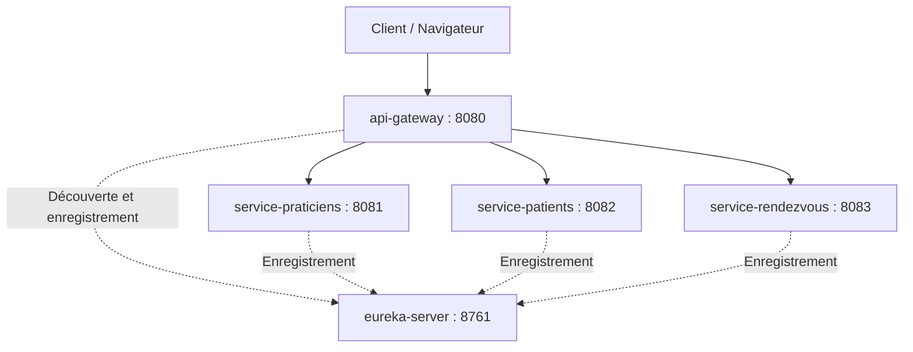
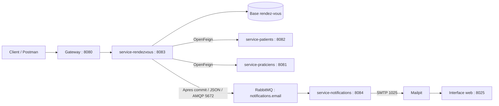

# Med-RDV — Gestion des rendez-vous médicaux

## Présentation

Med-RDV est un projet d’application de gestion des rendez-vous
médicaux pour un cabinet comprenant plusieurs praticiens.

Le périmètre fonctionnel prévu comprend :
- La gestion des praticiens et de leurs créneaux disponibles.
- La gestion des patients et de leurs dossiers médicaux de synthèse.
- La demande, la confirmation, la réalisation et l’annulation
  des rendez-vous.
- La consultation des allergies du patient avant la consultation.
- La mise à jour du dossier médical après la consultation.

L’application repose sur trois services métier indépendants :
- `service-praticiens`
- `service-patients`
- `service-rendezvous`

Un serveur Eureka et une API Gateway assurent l’enregistrement,
la découverte des services et le routage dynamique des requêtes.

## Technologies

Java 17, Spring Boot 3.5.6, Spring Cloud 2025.0.0,
Spring Web, Spring Data JPA, H2, Eureka,
Spring Cloud Gateway WebFlux et Maven.

## Diagramme de classes

Le diagramme présente le modèle métier prévu, les relations
internes et les dépendances entre services.


## Architecture — Jalon 2

Le projet comprend cinq applications Spring Boot :
trois services métier, un serveur Eureka et une API Gateway.


| Application | Port |
|-------------|------|
| `eureka-server` | 8761 |
| `api-gateway` | 8080 |
| `service-praticiens` | 8081 |
| `service-patients` | 8082 |
| `service-rendezvous` | 8083 |

### Schéma d’architecture



Les services s’enregistrent dans Eureka.
La Gateway découvre les instances disponibles et leur transmet
les requêtes sans déclaration manuelle de routes.

Exemple :
`/service-patients/api/ping` est transmis au service patients
sous la forme `/api/ping`.

## Démarrage

1. Ouvrir le projet dans IntelliJ IDEA.
2. Charger les modules Maven et leurs dépendances.
3. Démarrer le serveur Eureka.
4. Démarrer les trois services métier.
5. Démarrer l’API Gateway.
6. Vérifier les applications enregistrées sur :
   http://localhost:8761/

Ne lancer qu’une instance de chaque application sur son port.

## Tests du jalon 2

Les tests suivants sont indiqués comme validés dans la documentation
du jalon 2. Ils seront à relancer après les modifications du jalon 3.

| Service | Accès direct | Accès via Gateway | Résultat documenté |
|---------|--------------|-------------------|-------------------|
| Praticiens | http://localhost:8081/api/ping | http://localhost:8080/service-praticiens/api/ping | HTTP 200 |
| Patients | http://localhost:8082/api/ping | http://localhost:8080/service-patients/api/ping | HTTP 200 |
| Rendez-vous | http://localhost:8083/api/ping | http://localhost:8080/service-rendezvous/api/ping | HTTP 200 |

Exemple de réponse :

```json
{
  "status": "OK",
  "service": "service-rendezvous"
}
```

Ces tests valident l’accès aux endpoints de test et le routage
de la Gateway. Ils ne remplacent pas les tests des API métier.

## Démonstration de découverte dynamique

### Procédure

1. Garder Eureka et la Gateway démarrés.
2. Arrêter puis relancer uniquement le service rendez-vous.
3. Attendre son enregistrement et sa découverte.
4. Tester :
   http://localhost:8080/service-rendezvous/api/ping

### Résultat attendu

L’appel retourne HTTP 200 sans modification des routes
ni redémarrage de la Gateway.

La preuve de cette manipulation reste à documenter.

## État d’avancement

### Réalisé selon la documentation du jalon 2

- Description du projet et découpage en trois services métier.
- Diagramme de classes et schéma d’architecture.
- Création et démarrage des trois modules métier.
- Mise en place du serveur Eureka.
- Configuration de l’enregistrement des services dans Eureka.
- Mise en place de la Gateway avec routage dynamique.
- Validation des trois endpoints `/api/ping` en accès direct.
- Validation des trois endpoints `/api/ping` via la Gateway.

### Vérifications et preuves à compléter

- Conserver une capture Eureka avec les quatre applications
  clientes en statut `UP`.
- Documenter la démonstration de découverte dynamique.
- Vérifier les API métier existantes via la Gateway.

### Développement métier à compléter ou à valider

- Entités et repositories.
- Couches Service et Controller métier.
- DTO validés et gestion des erreurs.
- Tests des fonctionnalités métier avec Postman.

## Livraison — Jalon 2

Le jalon 2 porte sur :
- Un serveur Eureka opérationnel.
- L’enregistrement et la découverte des services métier.
- Une API Gateway avec routage dynamique.
- Un schéma d’architecture indiquant les noms et ports.
- Une version du projet personnel publiée sur Git avec un tag.

Le tag `v2.0` est déjà publié dans le dépôt.
Les corrections ultérieures sont conservées dans l’historique Git.

Le dépôt à remettre est Med-RDV, et non le dépôt d’entraînement
e-commerce du TP.
## Jalon 5

[Guide et architecture des notifications](docs/jalon5.md).

<!-- BEGIN MEDRDV JALON5 -->
## Version v5.0 - Notifications asynchrones

### Objectif

Apres la validation en base d'un rendez-vous, le service rendez-vous
publie une demande de notification dans RabbitMQ.
Le service notifications consomme le message et envoie une confirmation
a l'adresse email du patient via Mailpit.

Le parcours metier n'appelle pas le controleur HTTP de notifications :
POST /notifications/email est reserve aux tests locaux.

### Architecture



### Technologies

- Java 17 et Spring Boot 3.5.6.
- Spring Cloud Config et Eureka.
- OpenFeign pour les appels synchrones.
- Spring AMQP et RabbitMQ pour les notifications asynchrones.
- Jakarta Validation et JavaMailSender.
- Mailpit pour consulter les emails de test.

### Ports

| Composant | Port |
|---|---:|
| Gateway | 8080 |
| Praticiens | 8081 |
| Patients | 8082 |
| Rendez-vous | 8083 |
| Notifications HTTP interne | 8084 |
| Eureka | 8761 |
| Config Server | 8888 |
| RabbitMQ AMQP | 5672 |
| Administration RabbitMQ | 15672 |
| Mailpit SMTP | 1025 |
| Mailpit web | 8025 |

### Configuration

La configuration SMTP et RabbitMQ est centralisee dans config-repo :

- service-notifications.properties
- service-rendezvous.properties

Les applications Java sont lancees sur Windows.
Les adresses 127.0.0.1 correspondent a cet environnement local.

Pour lire la configuration du tag v5.0, ajouter au lancement :

```text
--spring.cloud.config.label=v5.0
```

Utiliser uniquement des identifiants de demonstration dans le depot.
Ne jamais versionner de secrets de production.

### Demarrage

Pour les conteneurs deja crees :

```powershell
docker start rabbitmq
docker start mailpit
```

Ordre de lancement des applications :

1. Eureka et Config Server.
2. Services patients et praticiens.
3. Service rendez-vous.
4. Service notifications.
5. Gateway.

Laisser les terminaux ouverts et verifier les services metier dans Eureka.

### Creation d'un rendez-vous

Endpoint direct :

```http
POST http://localhost:8083/api/rendezvous
Content-Type: application/json
idempotencyKey: une-nouvelle-valeur-UUID
```

Corps :

```json
{
  "patientId": 1,
  "praticienId": 1,
  "dateHeure": "2026-12-15T14:30:00"
}
```

Adapter les identifiants a des personnes actives existantes et choisir
un creneau futur libre commencant a :00 ou :30.
Pour le parcours via Gateway, utiliser la route configuree dans le projet.

Resultat attendu : 201 Created, rendez-vous enregistre et email correspondant.

### Verification des notifications

- Envoi HTTP direct valide : 204 et email dans Mailpit.
- Adresse email invalide : 400.
- Mailpit arrete pendant un envoi HTTP direct : 503.
- Creation d'un rendez-vous : notification automatique par RabbitMQ.
- Notifications arrete : les demandes restent en attente.
- Redemarrage de notifications : traitement des messages et reception des emails.

Pour le test de traitement differe, creer deux rendez-vous pendant
l'arret de notifications, verifier une augmentation de Ready de deux,
puis redemarrer le consommateur et verifier les deux emails.
Ready et Unacked doivent revenir a zero apres traitement.

Commande de controle :

```powershell
docker exec rabbitmq rabbitmqctl list_queues name messages_ready messages_unacknowledged consumers
```

Les tests ont ete declares reussis pendant la verification locale.
Conserver les reponses Postman et captures correspondantes pour le rendu.

### Collection Postman

Importer le fichier :

```text
postman/jalon5.postman_collection.json
```

Renseigner les variables de collection avant execution :
patientId, praticienId, dateHeure et gatewayRdvUrl.

Le test 503 necessite l'arret manuel de Mailpit, puis son redemarrage.
Ne pas executer toute la collection sans respecter ces preconditions.

### Limites

- Publication uniquement apres commit de la transaction.
- Un echec de publication est journalise sans annuler le rendez-vous.
- Pas d'outbox ni de confirmations de publication dans cette version.
- Trois tentatives de traitement configurees.
- Pas de DLQ : un echec definitif peut supprimer le message.
- Les donnees H2 en memoire peuvent disparaitre au redemarrage.

### Livrables

- Code du producteur et du consommateur.
- Configuration centralisee.
- Schema d'architecture.
- Collection Postman et preuves des tests.
- Guide complementaire : [docs/jalon5.md](docs/jalon5.md).
<!-- END MEDRDV JALON5 -->
