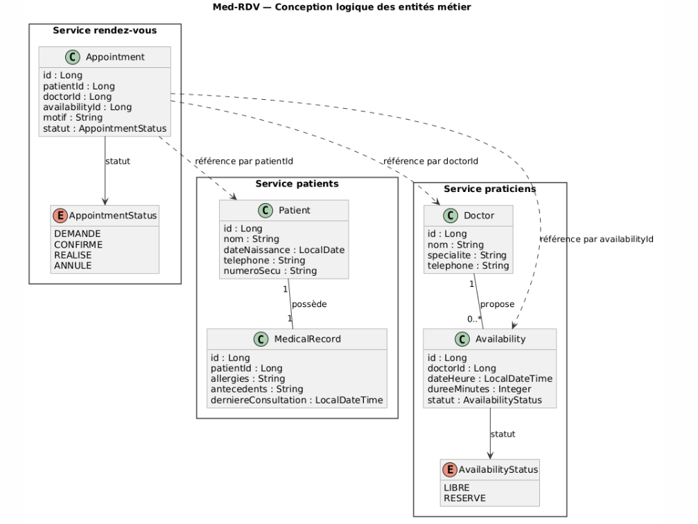
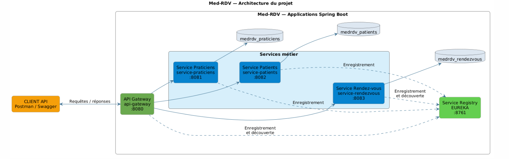

# Med-RDV — Gestion des rendez-vous médicaux

## Description du projet

Med-RDV est une application de gestion de rendez-vous médicaux
pour un cabinet comprenant plusieurs praticiens.

Elle permet de gérer les praticiens et leurs créneaux disponibles,
les patients et leurs dossiers médicaux de synthèse, ainsi que
le cycle de vie des rendez-vous : demande, confirmation,
réalisation et annulation.

Avant la consultation, le praticien peut consulter les allergies
du patient. Après la consultation, le dossier médical est mis à jour.

L’application repose sur trois services métier indépendants :
- service-praticiens ;
- service-patients ;
- service-rendezvous.

Un serveur Eureka et une API Gateway complètent cette architecture.

## Diagramme de classes

Le diagramme suivant présente les entités des trois services métier,
leurs relations internes et les dépendances entre services.

## Architecture du projet

Le projet est composé de cinq applications Spring Boot :
trois services métier, un serveur Eureka et une API Gateway.

### Applications et ports

| Application | Port |
|-------------|------|
| API Gateway | 8080 |
| Service Praticiens | 8081 |
| Service Patients | 8082 |
| Service Rendez-vous | 8083 |
| Serveur Eureka | 8761 |

## État d'avancement

### Réalisé
- Description du projet.
- Diagramme de classes global.
- Schéma d'architecture avec les noms et ports des applications.
- Création des trois modules métier.
- Démarrage du service praticiens sur le port 8081.
- Vérification du service praticiens avec GET /api/ping.

### En cours et prochaines étapes
- Vérification du démarrage des services patients et rendez-vous.
- Développement des entités et des repositories.
- Développement des couches Service et Controller.
- Mise en place des DTO validés et de la gestion des erreurs.
- Tests Postman des API métier.

### Livraison
Le jalon de développement v1.0 est en cours.
Le tag v1.0 sera créé après validation des fonctionnalités
et des tests demandés.
