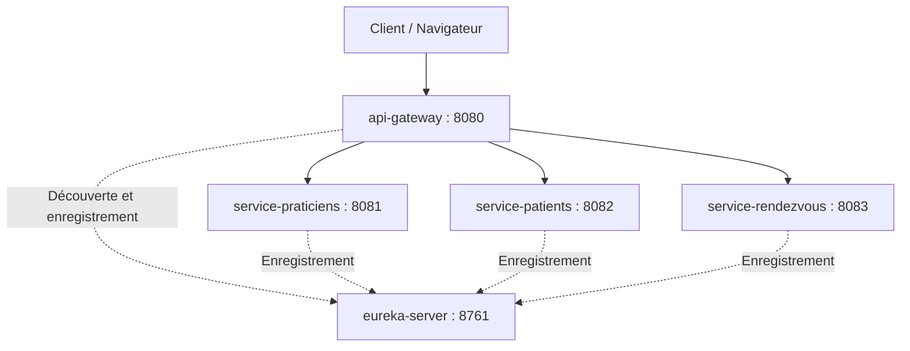

# Med-RDV — Gestion des rendez-vous médicaux

## Présentation

Med-RDV est un projet de gestion des rendez-vous médicaux
pour un cabinet comprenant plusieurs praticiens.

Le périmètre fonctionnel prévu comprend :
- La gestion des praticiens et de leurs créneaux.
- La gestion des patients et de leurs dossiers médicaux.
- La demande, la confirmation, la réalisation et l’annulation
  des rendez-vous.

## Technologies

Java 17, Spring Boot 3.5.6, Spring Cloud 2025.0.0,
Spring Web, Spring Data JPA, H2, Eureka, Spring Cloud
Gateway WebFlux et Maven.

## Diagramme de classes


## Architecture — Jalon 2

Le projet comprend trois services métier, un serveur Eureka
et une API Gateway.


| Application | Port |
|-------------|------|
| eureka-server | 8761 |
| api-gateway | 8080 |
| service-praticiens | 8081 |
| service-patients | 8082 |
| service-rendezvous | 8083 |



La Gateway découvre les services enregistrés dans Eureka
et leur transmet les requêtes par routage dynamique.

Exemple :
`/service-patients/api/ping` est transmis au service patients
sous la forme `/api/ping`.

## Démarrage

1. Ouvrir le projet dans IntelliJ IDEA et charger les modules Maven.
2. Démarrer le serveur Eureka.
3. Démarrer les trois services métier.
4. Démarrer l’API Gateway.
5. Vérifier l’enregistrement des applications sur :
   http://localhost:8761/

Ne lancer qu’une instance de chaque application sur son port.

## Tests validés

| Service | Accès direct | Accès via Gateway | Résultat |
|---------|--------------|-------------------|----------|
| Praticiens | http://localhost:8081/api/ping | http://localhost:8080/service-praticiens/api/ping | HTTP 200 |
| Patients | http://localhost:8082/api/ping | http://localhost:8080/service-patients/api/ping | HTTP 200 |
| Rendez-vous | http://localhost:8083/api/ping | http://localhost:8080/service-rendezvous/api/ping | HTTP 200 |

Exemple de réponse :

```json
{
  "status": "OK",
  "service": "service-rendezvous"
}
```

Ces tests valident l’accès aux services et le routage de la Gateway.
Ils ne remplacent pas les tests des fonctionnalités métier.

## Démonstration de découverte dynamique

Pour vérifier qu’un service devient accessible sans modifier
les routes ni redémarrer la Gateway :

1. Garder Eureka et la Gateway démarrés.
2. Arrêter puis relancer uniquement le service rendez-vous.
3. Attendre son enregistrement et sa découverte.
4. Tester :
   http://localhost:8080/service-rendezvous/api/ping

Résultat attendu : HTTP 200, sans redémarrage de la Gateway.

## Livraison

Le jalon 2 comprend :
- Un serveur Eureka et l’enregistrement des services métier.
- Une Gateway avec routage dynamique.
- Un schéma d’architecture indiquant les noms et ports.
- Le projet personnel Med-RDV publié sur Git avec un tag.
