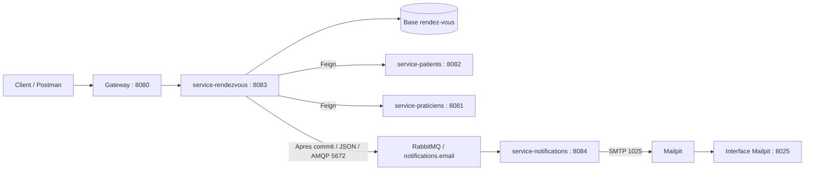

# Jalon 5 - Notifications asynchrones Med-RDV

## Objectif

Apres validation de la transaction de creation d'un rendez-vous,
service-rendezvous publie une demande JSON dans RabbitMQ.
service-notifications consomme cette demande et envoie l'email via Mailpit.

Le controleur POST /notifications/email sert seulement au test local.
Le parcours metier ne l'appelle pas.

## Architecture



## Configuration

- Java 17, Spring Boot 3.5.6.
- Configuration SMTP et RabbitMQ dans config-repo.
- Config Server : 8888 ; Eureka : 8761.
- Applications Java lancees sur Windows.
- RabbitMQ et Mailpit lances dans Docker.
- Pour reproduire la version publiee, utiliser :
  --spring.cloud.config.label=v5.0

Les identifiants RabbitMQ de demonstration sont dans la configuration locale.
Ne pas utiliser de secrets de production dans Git.

## Demarrage

Conteneurs existants :

    docker start rabbitmq
    docker start mailpit

Ordre de lancement :

1. Eureka et Config Server.
2. service-patients et service-praticiens.
3. service-rendezvous.
4. service-notifications.
5. api-gateway.

Laisser les terminaux ouverts.

## Requete de creation

Chemin direct verifie :

    POST http://localhost:8083/api/rendezvous
    Content-Type: application/json
    idempotencyKey: une nouvelle valeur UUID

Exemple de corps, a adapter aux IDs et a un creneau futur libre :

```json
{
  "patientId": 1,
  "praticienId": 1,
  "dateHeure": "2026-12-15T14:30:00"
}
```

Pour le test final, utiliser le routage reel de la Gateway.
Ne pas supposer que l'ID 1 existe : consulter les listes des services.

## Tests a documenter

| Scenario | Resultat attendu | Resultat observe |
|---|---|---|
| Creation via Gateway | 201 et email correspondant | A renseigner |
| SMTP direct valide | 204 et email Mailpit | A renseigner |
| Adresse invalide | 400 | A renseigner |
| Mailpit arrete, appel HTTP direct | 503 | A renseigner |
| Notifications arrete, deux creations | Deux 201, Ready augmente de 2 | A renseigner |
| Redemarrage notifications | Deux emails, Ready et Unacked a 0 | A renseigner |

Conserver les reponses HTTP, les captures Mailpit et les compteurs RabbitMQ.
Importer la collection du dossier postman et sauvegarder les reponses obtenues.

## Limites

- Publication apres commit : aucune notification en cas de rollback.
- Si la publication RabbitMQ echoue, le rendez-vous reste enregistre.
- Pas d'outbox ni de confirmations de publication.
- Trois tentatives de traitement configurees.
- Sans DLQ, un message peut etre supprime apres echec definitif.
- H2 en memoire : ne pas compter sur la conservation des donnees
  apres redemarrage des services.

## Etat de validation

Une compilation reussie ne remplace pas les tests du parcours asynchrone.
Completer les resultats observes avant de declarer le jalon termine.